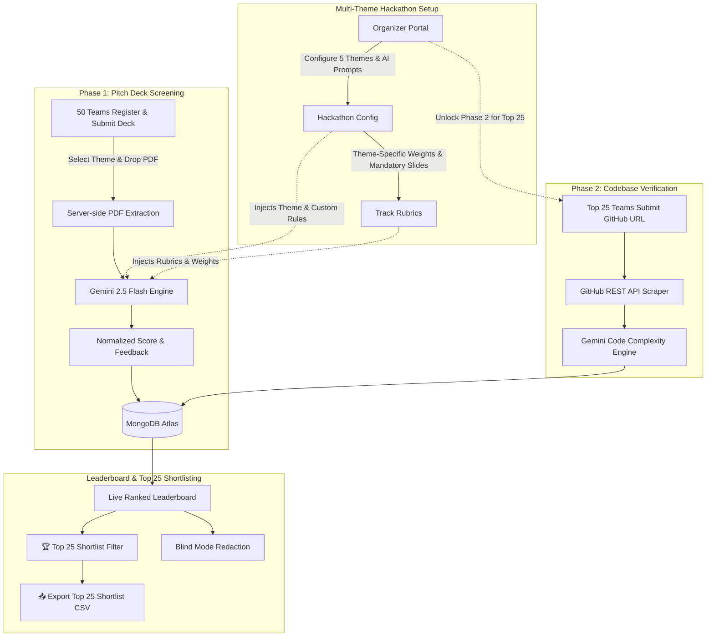

<div align="center">

# 🚀 Hackathon ATS
### Multi-Theme Applicant Tracking, AI Pitch Deck Screening & Judging Platform

[](https://nextjs.org/)
[](https://www.typescriptlang.org/)
[](https://ai.google.dev/)
[](https://www.mongodb.com/)
[](https://tailwindcss.com/)

<br/>

**Transforming hackathon screening and evaluation from hours of manual fatigue into seconds of algorithmic, multi-theme, bias-free, and actionable intelligence.**

[📖 How It Works](#-how-it-works-the-shortlisting-pipeline) • [✨ Key Features](#-key-features) • [🏗️ Architecture](#-architecture--workflow) • [🛠️ Tech Stack](#️-technology-stack) • [🚀 Quickstart](#-quickstart)

</div>

---

## 📌 The Problem We Are Solving

In every hackathon with 50+ or 100+ participating teams across multiple themes, organizers and judges face critical bottlenecks:

1. **Massive Evaluation Latency:** Reviewing 50+ 10-slide pitch decks manually takes 2–3 full days, leading to judge fatigue, delayed round announcements, and subjective grading.
2. **Shortlisting Bottleneck:** Selecting the **Top 25 teams** to advance to the coding round requires aggregating scores across different judges and themes, causing errors and bias.
3. **Theme & Domain Inconsistencies:** A single generic rubric cannot fairly judge an AI agent project versus a FinTech smart contract or a HealthTech diagnostic app.
4. **Plagiarism & Tutorial Forks:** Cliché ideas and generic open-source forks frequently slip past manual reviewers.
5. **Zero Actionable Feedback:** Over 90% of participating teams never receive constructive feedback on why their project was not shortlisted.

**Hackathon ATS solves this end-to-end** with an automated screening pipeline that evaluates pitch decks against theme-specific rubrics, flags cliches, enforces blind judging, algorithmically determines the **Top 25 Shortlist**, and unlocks Phase 2 GitHub codebase verification.

---

## 🔄 How It Works: The Shortlisting Pipeline

```
  50 Registered Teams                    Automated AI Screening                      Leaderboard & Shortlist
┌──────────────────────┐               ┌─────────────────────────┐               ┌──────────────────────────────┐
│  Team Leader Enters: │               │  Gemini 2.5 Flash       │               │  Live Ranked Leaderboard     │
│  • Team Info & Track │ ────────────> │  • Reads PPT Text       │ ────────────> │  • 🏆 Top 25 Qualifiers Tag  │
│  • Problem Statement │  Uploads PDF  │  • Theme-Specific Score │               │  • Cutoff Score Computed     │
│  • Pitch Deck (PDF)  │               │  • Plagiarism & Cliches │               │  • One-Click Shortlist CSV   │
└──────────────────────┘               └─────────────────────────┘               └──────────────┬───────────────┘
                                                                                                │ Organizers Unlock
                                                                                                ▼ Phase 2
                                                                                 ┌──────────────────────────────┐
                                                                                 │  Phase 2: Codebase Round     │
                                                                                 │  Top 25 submit GitHub URL    │
                                                                                 │  for automated code review   │
                                                                                 └──────────────────────────────┘
```

1. **Theme Selection:** Teams choose from 5 built-in hackathon themes:
   * 🤖 **AI & Machine Learning** (LLMs, Agentic Workflows, Computer Vision)
   * 💳 **FinTech & Web3** (DeFi, Security, Fraud Detection, Smart Contracts)
   * 🏥 **HealthTech & Life Sciences** (Clinical Utility, HIPAA, Diagnostics)
   * 🌿 **Smart Cities & Sustainability** (IoT, Clean Energy, Urban Efficiency)
   * 💡 **Open Innovation** (EdTech, DevTools, Social Impact)
2. **Instant AI Scoring:** Gemini 2.5 Flash evaluates the deck in seconds against the chosen theme's rubrics (Innovation, Feasibility, Completeness) and checks for mandatory slides.
3. **Automated Cutoff & Top 25 Shortlist:** The system ranks all submissions, establishes the cutoff score, and highlights the **Top 25 Qualified** teams on the leaderboard.
4. **Phase 2 Codebase Round:** Organizers unlock Phase 2 so shortlisted teams can submit their GitHub repository for deep codebase, dependency, and commit-history inspection.

---

## ✨ Key Features

### 1. 🏆 Automated Top 25 Shortlist & Cutoff Engine
- **One-Click Shortlist Filter:** Instantly switch between `All Teams`, `🏆 Top 25 Shortlist`, and `⭐ Top 10 Finalists`.
- **Visual Qualification Badges:** Teams ranked in the Top 25 automatically receive a green **`🏆 Top 25 Qualified`** badge.
- **Dynamic Cutoff Calculation:** Displays the live minimum score required to qualify for Round 2.
- **Dedicated Shortlist Export:** Download a sorted CSV of only the Top 25 shortlisted teams for announcements.

### 2. 🎪 Multi-Theme & Multi-Hackathon Support
- **5 Built-In Domain Themes:** Pre-configured rubrics and required slides tailored for AI, FinTech, HealthTech, Smart Cities, and Open Innovation.
- **Custom Organizer Prompts:** Organizers can tune Gemini's evaluation criteria (e.g., *"Heavily penalize ideas lacking user privacy; reward production prototypes"*).
- **Multi-Event Portal (`/admin/hackathons`):** Run multiple independent hackathons simultaneously with distinct themes and rules.

### 3. 📑 Automated Pitch Deck Screening
- Accepts presentation decks in PDF format.
- Extracts clean text server-side using `pdf2json` without external OCR dependencies.
- Analyzes problem-solution fit, innovation, and technical feasibility using **Google Gemini 2.5 Flash**.
- Computes normalized `0–100` ATS scores and checks for mandatory slides (e.g., *Architecture*, *Data Pipeline*).

### 4. 🛡️ Anti-Cliché & Idea Plagiarism Detector
- Leverages Gemini's knowledge base to screen submitted proposals against overused hackathon ideas and generic open-source tutorial clones.
- Surfaces discreet warning badges and detailed rationale on the judge scorecard for derivative submissions.

### 5. 🕶️ "Blind" Judging Mode
- Organizers can enable Blind Mode with a single toggle.
- Automatically redacts team names, member identities, student IDs, and repository URLs across the entire admin dashboard, leaderboard, and PDF reports to ensure 100% merit-based evaluation.

### 6. 🐙 Phase 2: Dynamic GitHub Codebase Analysis
- Organizers unlock Phase 2 code evaluation for shortlisted qualifiers.
- Ingests repository metadata, `README.md`, dependencies (`package.json`), and commit histories via the GitHub REST API.
- Evaluates technical complexity (`0–100`), architecture quality, and authentic development activity.

### 7. 📊 Interactive Visual Scorecards & PDF Export
- Recharts-powered **Radar Charts** map skill distributions across Innovation, Feasibility, and Completeness.
- Instant client-side **PDF Scorecard Generation** (`jsPDF`) giving teams a branded summary of their score, strengths, and areas for improvement.

---

## 🏗️ Architecture & Workflow



---

## 🛠️ Technology Stack

| Layer | Technology | Purpose |
|---|---|---|
| **Framework** | Next.js 16 (App Router, Turbopack / Webpack) | High-performance React SSR & API routes |
| **Language** | TypeScript 5.0 | End-to-end type safety |
| **Styling** | Tailwind CSS v4, Lucide Icons | Responsive, modern dark-mode design |
| **AI Model** | Google Gemini 2.5 Flash (`@google/genai`) | Lightning-fast structured JSON evaluation with prompt conditioning |
| **Database** | MongoDB Atlas with Mongoose ODM | Hackathons, submissions, teams, tracks & settings persistence |
| **Auth** | NextAuth.js (v4) with bcryptjs | Secure JWT credential authentication for judges |
| **Document Processing** | `pdf2json` | Serverless-safe text extraction from PDF buffers |
| **Reporting** | `jsPDF` + `jspdf-autotable` | Client-side branded scorecard PDF generation |
| **Analytics** | Recharts | Multi-axis radar visualizations |
| **Deployment** | Node.js Server / Edge Runtime | Production-ready edge deployment |

---

## 📁 Repository Structure

```
├── public/                  # Static assets & icons
├── src/
│   ├── app/
│   │   ├── admin/           # Admin leaderboard, settings, hackathons & scorecard pages
│   │   │   ├── hackathons/  # Multi-hackathon management portal (CRUD, prompts, tracks)
│   │   │   ├── settings/    # Event settings & rubric management
│   │   │   ├── submission/  # Detailed submission scorecards & radar view
│   │   │   └── page.tsx     # Live ranked leaderboard with Top 25 shortlist filter
│   │   ├── api/             # RESTful API endpoints
│   │   │   ├── hackathons/  # Hackathon CRUD endpoints with dynamic slug generation
│   │   │   ├── upload/      # Pitch deck upload & Gemini evaluation pipeline
│   │   │   ├── submit-code/ # Phase 2 GitHub repository analysis
│   │   │   ├── submissions/ # Filtered submissions by hackathon, theme & team
│   │   │   ├── teams/       # Team retrieval & metadata
│   │   │   ├── export/      # CSV leaderboard & Top 25 export
│   │   │   └── auth/        # NextAuth authentication handlers
│   │   ├── dashboard/       # Participant self-service status portal
│   │   ├── login/           # Judge / Admin authentication portal
│   │   ├── submit-code/     # Phase 2 GitHub codebase submission portal
│   │   ├── layout.tsx       # Root layout & providers
│   │   └── page.tsx         # Participant landing page with theme selector
│   ├── components/          # Reusable UI & presentation components
│   │   ├── DocumentUpload.tsx # Pitch deck uploader with dynamic hackathon briefs
│   │   ├── ScoreRadarChart.tsx# Recharts radar skill visualization
│   │   ├── Navbar.tsx       # Navigation bar with role-based links
│   │   └── ui/              # shadcn/ui primitives
│   ├── lib/                 # Core utility modules
│   │   ├── auth.ts          # NextAuth configuration & admin auto-seed
│   │   ├── gemini.ts        # Gemini 2.5 Flash prompts, custom prompt injection & parsers
│   │   ├── github.ts        # GitHub API repository metadata & commit fetcher
│   │   ├── hackathon-service.ts # Hackathon seeding & backward-compatibility resolver
│   │   ├── mongodb.ts       # Cached MongoDB Mongoose connection handler
│   │   ├── pdf-generator.ts # jsPDF scorecard generation logic
│   │   └── pdf-parser.ts    # pdf2json memory buffer extraction
│   └── models/              # Mongoose schema definitions
│       ├── Hackathon.ts     # Multi-hackathon schema (themes, prompts, tracks, phases)
│       ├── Settings.ts      # Global configuration & default track rubrics
│       ├── Submission.ts    # Evaluation scores, criteria & feedback
│       ├── Team.ts          # Team metadata, tracks & members
│       └── User.ts          # Authentication roles (Admin, Judge, Participant)
└── package.json
```

---

## 🚀 Quickstart

### 1. Clone the repository
```bash
git clone https://github.com/AnshGour16/Hackathon-ATS.git
cd Hackathon-ATS
```

### 2. Install dependencies
```bash
npm install
```

### 3. Configure environment variables
Create a `.env.local` file in the root directory:
```env
MONGODB_URI=your_mongodb_connection_string
GEMINI_API_KEY=your_gemini_api_key
NEXTAUTH_SECRET=your_nextauth_secret_key
NEXTAUTH_URL=http://localhost:3000
```

### 4. Run the development server
```bash
npm run dev
```

Open [http://localhost:3000](http://localhost:3000) to view the application.

---

## 🔑 Judge / Admin Credentials for Testing

To test the admin features out of the box, use the default credentials:
- **Portal:** `/login` or click **Judge Login** on the navbar
- **Email:** `admin@hackathon.com`
- **Password:** `admin123`

*(The database automatically initializes this account on your first login attempt if it does not already exist.)*

---

## 🛡️ Security & Privacy

- **Safe Credential Handling:** Passwords hashed with `bcryptjs` (salt factor 10); environment variables sanitized to prevent credential leakages.
- **Serverless Resilience:** PDF processing operates in-memory with graceful fallback for read-only serverless filesystems.
- **API Protection:** Admin mutation endpoints enforce NextAuth session role validation.

---

## 📄 License

This project is licensed under the [MIT License](LICENSE).
