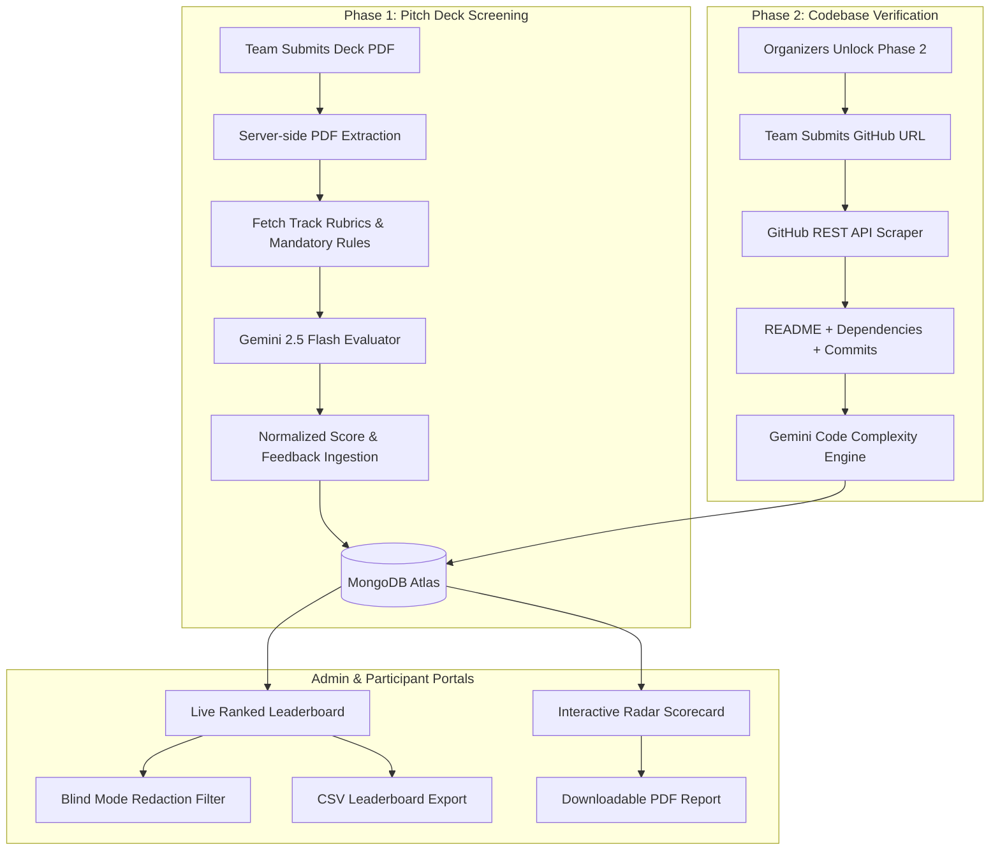

<div align="center">

# 🚀 Hackathon ATS
### AI-Powered Automated Applicant Tracking & Multi-Phase Judging System

[](https://nextjs.org/)
[](https://www.typescriptlang.org/)
[](https://ai.google.dev/)
[](https://www.mongodb.com/)
[](https://tailwindcss.com/)

<br/>

**Transforming hackathon evaluations from hours of manual fatigue into seconds of algorithmic, bias-free, and actionable intelligence.**

[📖 Architecture](#-architecture--workflow) • [✨ Key Features](#-key-features) • [🛠️ Tech Stack](#️-technology-stack) • [🚀 Quickstart](#-quickstart)

</div>

---

## 📌 The Problem We Are Solving

Hackathon organizing teams and judges face three critical bottlenecks during every event:

1. **Massive Evaluation Latency:** Reviewing hundreds of 10-slide pitch decks manually takes days, leading to judge fatigue, subjective grading, and inconsistent score distributions.
2. **Zero Actionable Feedback:** Over 90% of participating teams never receive constructive feedback on why their project was rejected or what was missing.
3. **Evaluation Bias & Plagiarism:** Unconscious bias based on college names or participant backgrounds frequently skews results, while duplicate or cliché ideas (e.g., standard tutorial forks) slip past manual reviewers.

**Hackathon ATS solves this end-to-end** with an automated, two-phase AI pipeline that scores pitch decks against track-specific rubrics, flags cliches, enforces blind judging, and inspects GitHub codebases directly.

---

## ✨ Key Features

### 1. 📑 Automated Pitch Deck Screening
- Accepts presentation decks in PDF format.
- Extracts clean text server-side using `pdf2json` without external OCR dependencies.
- Analyzes problem-solution fit, innovation, and feasibility using **Google Gemini 2.5 Flash**.
- Computes normalized `0–100` ATS scores and checks for mandatory slides (e.g., *Revenue Model*, *System Architecture*).

### 2. 🛡️ Anti-Cliché & Idea Plagiarism Detector
- Leverages Gemini's knowledge base to screen submitted proposals against overused hackathon ideas and generic open-source tutorial clones.
- Surfaces discreet warning badges and detailed rationale on the judge scorecard for derivative submissions.

### 3. 🕶️ "Blind" Judging Mode
- Organizers can enable Blind Mode with a single toggle.
- Automatically redacts team names, member identities, student IDs, and repository URLs across the entire admin dashboard, leaderboard, and PDF reports to ensure 100% merit-based evaluation.

### 4. 🐙 Phase 2: Dynamic GitHub Codebase Analysis
- Organizers can lock or unlock Phase 2 dynamically from the Admin Settings.
- When unlocked, participants submit their public GitHub repository.
- The backend pings the GitHub REST API to ingest repository metadata, `README.md`, `package.json` dependencies, and commit history.
- Evaluates technical complexity (`0–100`), code quality, and development activity.

### 5. 📊 Interactive Visual Scorecards & PDF Export
- Recharts-powered **Radar Charts** map skill distributions across Innovation, Feasibility, and Completeness.
- Instant client-side **PDF Scorecard Generation** (`jsPDF`) giving teams a branded summary of their score, strengths, and areas for improvement.
- One-click **Leaderboard CSV Export** for organizers to download sorted rankings.

---

## 🏗️ Architecture & Workflow



---

## 🛠️ Technology Stack

| Layer | Technology | Purpose |
|---|---|---|
| **Framework** | Next.js 16 (App Router, Turbopack / Webpack) | High-performance React SSR & API routes |
| **Language** | TypeScript 5.0 | End-to-end type safety |
| **Styling** | Tailwind CSS v4, Lucide Icons | Responsive, modern dark-mode design |
| **AI Model** | Google Gemini 2.5 Flash (`@google/genai`) | Lightning-fast structured JSON evaluation |
| **Database** | MongoDB Atlas with Mongoose ODM | Submissions, teams, tracks & settings persistence |
| **Auth** | NextAuth.js (v4) with bcryptjs | Secure JWT credential authentication for judges |
| **Document Processing** | `pdf2json` | Serverless-safe text extraction from PDF buffers |
| **Reporting** | `jsPDF` + `jspdf-autotable` | Client-side branded scorecard PDF generation |
| **Analytics** | Recharts | Multi-axis radar visualizations |
| **Deployment** | Node.js Server / Edge Runtime | Production-ready edge deployment |

---

## 📁 Repository Structure

```
├── public/                  # Static assets & icons
├── src/
│   ├── app/
│   │   ├── admin/           # Admin leaderboard, settings & scorecard pages
│   │   ├── api/             # API routes (upload, submissions, auth, github, export)
│   │   ├── dashboard/       # Participant self-service status portal
│   │   ├── login/           # Judge / Admin authentication portal
│   │   ├── submit-code/     # Phase 2 GitHub codebase submission portal
│   │   ├── layout.tsx       # Root layout & providers
│   │   └── page.tsx         # Landing page & submission portal
│   ├── components/          # Reusable UI & presentation components
│   │   ├── DocumentUpload.tsx # Drag & drop pitch deck uploader
│   │   ├── ScoreRadarChart.tsx# Recharts radar skill visualization
│   │   ├── Navbar.tsx       # Navigation bar with role-based links
│   │   └── ui/              # shadcn/ui primitives
│   ├── lib/                 # Core utility modules
│   │   ├── auth.ts          # NextAuth configuration & admin auto-seed
│   │   ├── gemini.ts        # Gemini 2.5 Flash evaluation prompts & parsers
│   │   ├── github.ts        # GitHub API repository metadata & commit fetcher
│   │   ├── mongodb.ts       # Cached MongoDB Mongoose connection handler
│   │   ├── pdf-generator.ts # jsPDF scorecard generation logic
│   │   └── pdf-parser.ts    # pdf2json memory buffer extraction
│   └── models/              # Mongoose schema definitions
│       ├── Settings.ts      # Global hackathon rules, blind mode & tracks
│       ├── Submission.ts    # Evaluation scores, criteria & feedback
│       ├── Team.ts          # Team metadata, tracks & members
│       └── User.ts          # Authentication roles (Admin, Judge, Participant)
└── package.json
```

---

## 🚀 Quickstart

### 1. Clone the repository
```bash
git clone https://github.com/AnshGour16/Hackathon-ATS.git
cd Hackathon-ATS
```

### 2. Install dependencies
```bash
npm install
```

### 3. Configure environment variables
Create a `.env.local` file in the root directory:
```env
MONGODB_URI=your_mongodb_connection_string
GEMINI_API_KEY=your_gemini_api_key
NEXTAUTH_SECRET=your_nextauth_secret_key
NEXTAUTH_URL=http://localhost:3000
```

### 4. Run the development server
```bash
npm run dev
```

Open [http://localhost:3000](http://localhost:3000) to view the application.

---

## 🔑 Judge / Admin Credentials for Testing

To test the admin features out of the box, use the default credentials:
- **Portal:** `/login` or click **Judge Login** on the navbar
- **Email:** `admin@hackathon.com`
- **Password:** `admin123`

*(The database automatically initializes this account on your first login attempt if it does not already exist.)*

---

## 🛡️ Security & Privacy

- **Safe Credential Handling:** Passwords hashed with `bcryptjs` (salt factor 10); environment variables sanitized to prevent credential leakages.
- **Serverless Resilience:** PDF processing operates in-memory with graceful fallback for read-only serverless filesystems.
- **API Protection:** Admin mutation endpoints enforce NextAuth session role validation.

---

## 📄 License

This project is licensed under the [MIT License](LICENSE).
