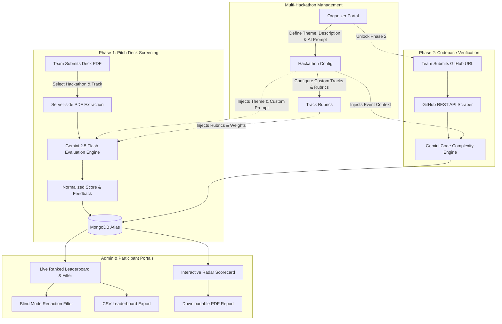

<div align="center">

# 🚀 Hackathon ATS
### Multi-Event Applicant Tracking, Custom AI Evaluation & Judging Platform

[](https://nextjs.org/)
[](https://www.typescriptlang.org/)
[](https://ai.google.dev/)
[](https://www.mongodb.com/)
[](https://tailwindcss.com/)

<br/>

**Transforming hackathon screening and evaluation from hours of manual fatigue into seconds of algorithmic, multi-tenant, bias-free, and actionable intelligence.**

[📖 Architecture](#-architecture--workflow) • [✨ Key Features](#-key-features) • [🛠️ Tech Stack](#️-technology-stack) • [🚀 Quickstart](#-quickstart)

</div>

---

## 📌 The Problem We Are Solving

Hackathon organizing teams and judges face critical bottlenecks during every event:

1. **Massive Evaluation Latency:** Reviewing hundreds of pitch decks manually takes days, leading to judge fatigue, subjective grading, and inconsistent score distributions.
2. **One-Size-Fits-All Scoring:** Different hackathons have distinct themes, focus areas, and evaluation rules. Generic scoring cannot evaluate whether an idea adheres to a specific theme (e.g., healthcare privacy vs. web3 decentralization).
3. **Zero Actionable Feedback:** Over 90% of participating teams never receive constructive feedback on why their project was rejected or what was missing.
4. **Evaluation Bias & Plagiarism:** Unconscious bias based on college names or participant backgrounds frequently skews results, while duplicate or cliché ideas slip past manual reviewers.

**Hackathon ATS solves this end-to-end** with a multi-hackathon architecture featuring custom organizer AI prompts, automated pitch deck screening, anti-cliché detection, blind judging, and dynamic GitHub codebase inspection.

---

## ✨ Key Features

### 1. 🎪 Multi-Hackathon Hub with Custom AI Evaluation Prompts
- **Multi-Tenant Event Management:** Create and manage multiple distinct hackathons simultaneously from the `/admin/hackathons` portal.
- **Event-Specific Themes & Context:** Configure custom titles, problem descriptions, and themes (e.g., *AI for Sustainability*, *FinTech Innovation*).
- **Custom AI Prompt Tuning:** Organizers can inject custom prompt rules directly into the Gemini evaluation engine (e.g., *"Heavily reward real-world data validation; heavily penalize solutions lacking privacy safeguards"*).
- **Independent Phase & Blind Controls:** Toggle Phase 2 code submissions and blind judging independently per hackathon.

### 2. 📑 Automated Pitch Deck Screening
- Accepts presentation decks in PDF format.
- Extracts clean text server-side using `pdf2json` without external OCR dependencies.
- Evaluates submissions using **Google Gemini 2.5 Flash** against dynamic, hackathon-specific track rubrics and mandatory slide requirements (e.g., *Revenue Model*, *System Architecture*).
- Computes normalized `0–100` ATS scores with strengths, weaknesses, and clear recommendations.

### 3. 🛡️ Anti-Cliché & Idea Plagiarism Detector
- Leverages Gemini's contextual knowledge base to screen submitted proposals against overused hackathon ideas and generic open-source tutorial clones.
- Surfaces discreet warning badges and detailed rationale on the judge scorecard for derivative submissions.

### 4. 🕶️ "Blind" Judging Mode
- Organizers can enable Blind Mode with a single toggle per event.
- Automatically redacts team names, member identities, student IDs, and repository URLs across the admin dashboard, leaderboard, and PDF reports to ensure 100% merit-based evaluation.

### 5. 🐙 Phase 2: Dynamic GitHub Codebase Analysis
- Organizers can unlock Phase 2 code evaluation when teams qualify for the coding round.
- Ingests repository metadata, `README.md`, dependencies (`package.json`), and commit histories via the GitHub REST API.
- Evaluates technical complexity (`0–100`), architecture quality, and authentic development activity.

### 6. 📊 Interactive Visual Scorecards & PDF Export
- Recharts-powered **Radar Charts** map skill distributions across Innovation, Feasibility, and Completeness.
- Instant client-side **PDF Scorecard Generation** (`jsPDF`) giving teams a branded summary of their score, strengths, and areas for improvement.
- One-click **Leaderboard CSV Export** with hackathon filtering for organizers.

---

## 🏗️ Architecture & Workflow



---

## 🛠️ Technology Stack

| Layer | Technology | Purpose |
|---|---|---|
| **Framework** | Next.js 16 (App Router, Turbopack / Webpack) | High-performance React SSR & API routes |
| **Language** | TypeScript 5.0 | End-to-end type safety |
| **Styling** | Tailwind CSS v4, Lucide Icons | Responsive, modern dark-mode design |
| **AI Model** | Google Gemini 2.5 Flash (`@google/genai`) | Lightning-fast structured JSON evaluation with prompt conditioning |
| **Database** | MongoDB Atlas with Mongoose ODM | Hackathons, submissions, teams, tracks & settings persistence |
| **Auth** | NextAuth.js (v4) with bcryptjs | Secure JWT credential authentication for judges |
| **Document Processing** | `pdf2json` | Serverless-safe text extraction from PDF buffers |
| **Reporting** | `jsPDF` + `jspdf-autotable` | Client-side branded scorecard PDF generation |
| **Analytics** | Recharts | Multi-axis radar visualizations |
| **Deployment** | Node.js Server / Edge Runtime | Production-ready edge deployment |

---

## 📁 Repository Structure

```
├── public/                  # Static assets & icons
├── src/
│   ├── app/
│   │   ├── admin/           # Admin leaderboard, settings, hackathons & scorecard pages
│   │   │   ├── hackathons/  # Multi-hackathon management portal (CRUD, prompts, tracks)
│   │   │   ├── settings/    # Event settings & rubric management
│   │   │   ├── submission/  # Detailed submission scorecards & radar view
│   │   │   └── page.tsx     # Live ranked leaderboard with hackathon filters
│   │   ├── api/             # RESTful API endpoints
│   │   │   ├── hackathons/  # Hackathon CRUD endpoints with dynamic slug generation
│   │   │   ├── upload/      # Pitch deck upload & Gemini evaluation pipeline
│   │   │   ├── submit-code/ # Phase 2 GitHub repository analysis
│   │   │   ├── submissions/ # Filtered submissions by hackathon & team
│   │   │   ├── teams/       # Team retrieval & metadata
│   │   │   ├── export/      # CSV leaderboard export
│   │   │   └── auth/        # NextAuth authentication handlers
│   │   ├── dashboard/       # Participant self-service status portal
│   │   ├── login/           # Judge / Admin authentication portal
│   │   ├── submit-code/     # Phase 2 GitHub codebase submission portal
│   │   ├── layout.tsx       # Root layout & providers
│   │   └── page.tsx         # Participant landing page with hackathon selector
│   ├── components/          # Reusable UI & presentation components
│   │   ├── DocumentUpload.tsx # Pitch deck uploader with dynamic hackathon briefs
│   │   ├── ScoreRadarChart.tsx# Recharts radar skill visualization
│   │   ├── Navbar.tsx       # Navigation bar with role-based links
│   │   └── ui/              # shadcn/ui primitives
│   ├── lib/                 # Core utility modules
│   │   ├── auth.ts          # NextAuth configuration & admin auto-seed
│   │   ├── gemini.ts        # Gemini 2.5 Flash prompts, custom prompt injection & parsers
│   │   ├── github.ts        # GitHub API repository metadata & commit fetcher
│   │   ├── hackathon-service.ts # Hackathon seeding & backward-compatibility resolver
│   │   ├── mongodb.ts       # Cached MongoDB Mongoose connection handler
│   │   ├── pdf-generator.ts # jsPDF scorecard generation logic
│   │   └── pdf-parser.ts    # pdf2json memory buffer extraction
│   └── models/              # Mongoose schema definitions
│       ├── Hackathon.ts     # Multi-hackathon schema (themes, prompts, tracks, phases)
│       ├── Settings.ts      # Global configuration & default track rubrics
│       ├── Submission.ts    # Evaluation scores, criteria & feedback
│       ├── Team.ts          # Team metadata, tracks & members
│       └── User.ts          # Authentication roles (Admin, Judge, Participant)
└── package.json
```

---

## 🚀 Quickstart

### 1. Clone the repository
```bash
git clone https://github.com/AnshGour16/Hackathon-ATS.git
cd Hackathon-ATS
```

### 2. Install dependencies
```bash
npm install
```

### 3. Configure environment variables
Create a `.env.local` file in the root directory:
```env
MONGODB_URI=your_mongodb_connection_string
GEMINI_API_KEY=your_gemini_api_key
NEXTAUTH_SECRET=your_nextauth_secret_key
NEXTAUTH_URL=http://localhost:3000
```

### 4. Run the development server
```bash
npm run dev
```

Open [http://localhost:3000](http://localhost:3000) to view the application.

---

## 🔑 Judge / Admin Credentials for Testing

To test the admin features out of the box, use the default credentials:
- **Portal:** `/login` or click **Judge Login** on the navbar
- **Email:** `admin@hackathon.com`
- **Password:** `admin123`

*(The database automatically initializes this account on your first login attempt if it does not already exist.)*

---

## 🛡️ Security & Privacy

- **Safe Credential Handling:** Passwords hashed with `bcryptjs` (salt factor 10); environment variables sanitized to prevent credential leakages.
- **Serverless Resilience:** PDF processing operates in-memory with graceful fallback for read-only serverless filesystems.
- **API Protection:** Admin mutation endpoints enforce NextAuth session role validation.

---

## 📄 License

This project is licensed under the [MIT License](LICENSE).
